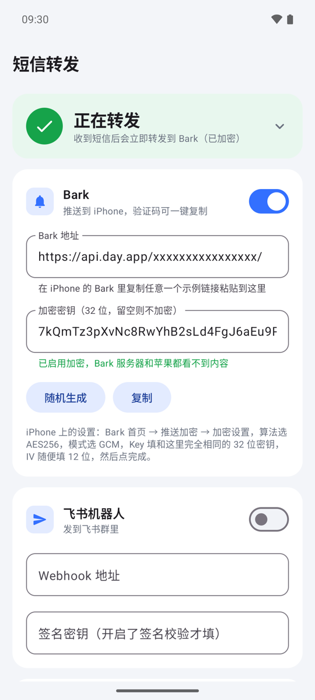
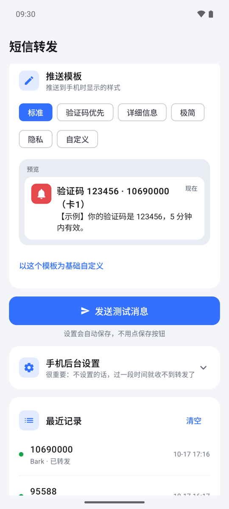
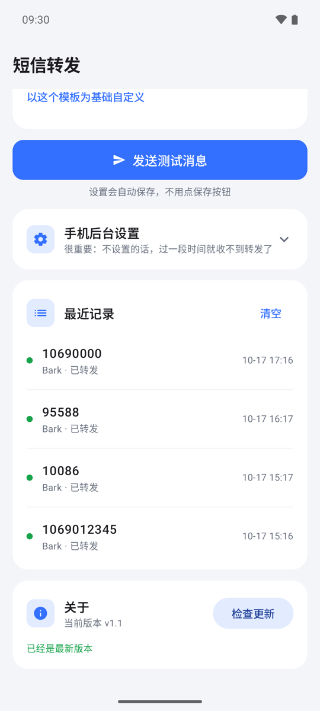
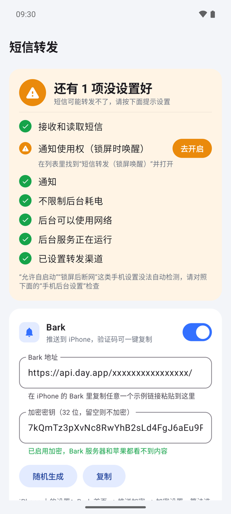
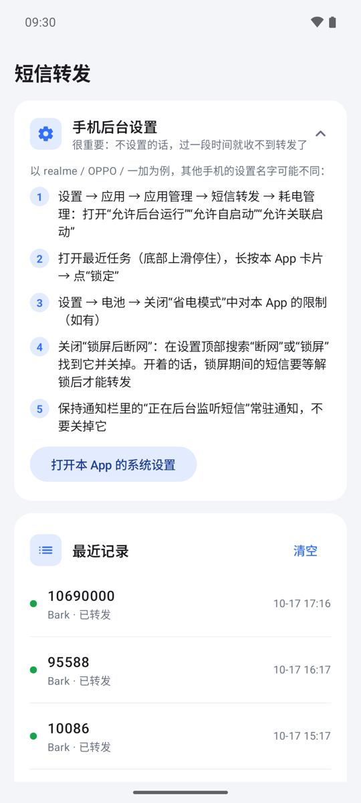
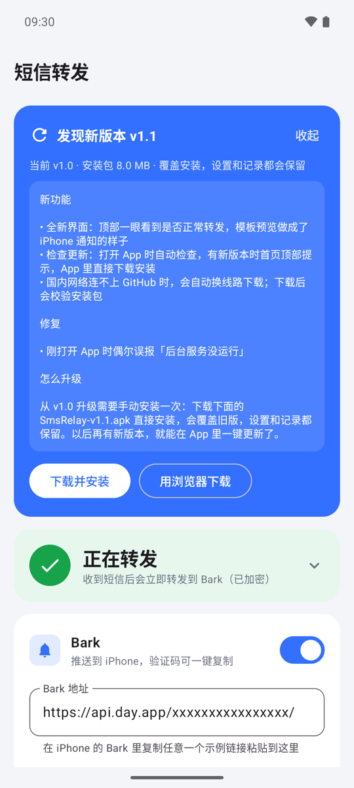

# 短信转发（SmsRelay）

[](https://github.com/suyin101/SmsRelay/releases/latest)
[](LICENSE)


把安卓手机收到的短信，实时转发到 iPhone（通过 [Bark](https://github.com/Finb/Bark)）或飞书群。

适合这种情况：手上有两台手机，一张卡放在安卓机里，不想随身带着它，又要能及时看到短信和验证码。

> [!NOTE]
> 主要在 realme（realme UI / ColorOS 系）手机上测试。其他安卓手机一般也能用，只是后台设置的位置可能不同。

**目录**

- [界面截图](#界面截图)
- [基本功能](#基本功能)
- [使用教程](#使用教程)
- [常见问题](#常见问题)
- [隐私与安全](#隐私与安全)
- [技术说明](#技术说明)
- [开源协议](#开源协议)

---

## 界面截图

<table>
  <tr>
    <td align="center"><br>首页：一眼看到是否在正常转发</td>
    <td align="center"><br>推送模板：实时预览 iPhone 上的样子</td>
    <td align="center"><br>最近记录和检查更新</td>
  </tr>
</table>

---

## 基本功能

| 功能 | 说明 |
|---|---|
| ⚡ 实时转发 | 收到短信后 1~2 秒就推送出去，锁屏时也能转发 |
| 📱 Bark 推送 | iPhone 上弹出通知，验证码可以一键复制 |
| 🔒 加密推送 | Bark 服务器和苹果都看不到短信内容 |
| 💬 飞书群机器人 | 发到飞书群里，支持签名校验 |
| 🔢 识别验证码 | 有验证码时单独显示在标题里 |
| 🎨 推送模板 | 内置 5 种样式，也可以自己写 |
| 📶 双卡 | 能区分是卡 1 还是卡 2 收到的 |
| 📄 长短信 | 被拆成几段的长短信会自动拼回一条 |
| 🔁 断网补发 | 没网时等联网后自动补发，最多重试 10 次 |
| ✅ 权限检查 | 没设置好的项会标出来，点「去开启」直接跳到设置页 |
| 📋 最近记录 | 显示最近 50 条转发结果，失败的会写原因 |
| 🚀 开机自启 | 手机重启后自动开始工作 |
| ⬆️ 检查更新 | 有新版本时首页顶部提示，App 里直接下载安装 |

Bark 和飞书两个渠道可以只开一个，也可以同时开。

### 推送模板

内置 5 种样式：**标准**、**验证码优先**、**详细信息**、**极简**、**隐私**。

也可以选「自定义」自己写，能用的参数：

| 参数 | 内容 |
|---|---|
| `{验证码}` | 自动识别，没有验证码时为空 |
| `{发件人}` | 对方号码 |
| `{卡号}` | 卡1 / 卡2，单卡时为空 |
| `{时间}` | 收到短信的时间 |
| `{短信内容}` | 短信原文 |
| `{手机名称}` | 这台安卓手机的名字 |

用 `[ ]` 括起来的一段，里面的参数为空时整段不显示。比如 `[验证码 {验证码} · ]{发件人}`：

- 有验证码时显示：`验证码 123456 · 10690000`
- 没有验证码时显示：`10690000`

---

## 使用教程

### 第 1 步：安装

**方法一：直接下载安装包（推荐）**

1. 在安卓手机上打开 [Releases 页面](https://github.com/suyin101/SmsRelay/releases/latest)，下载最新的 `SmsRelay-vX.X.apk`
2. 点开下载好的文件安装
3. 如果手机提示「禁止安装未知来源应用」，按提示允许浏览器（或文件管理）安装应用
4. 如果手机提示「未经检测的应用」「可能有风险」，选「继续安装」

> [!TIP]
> 出现风险提示是因为本 App 没有上架应用商店，不是病毒。代码全部公开在这个仓库里。

**方法二：自己编译**

1. 安装 [Android Studio](https://developer.android.com/studio)，用它打开本项目
2. 安卓手机打开「开发者选项」里的「USB 调试」，用数据线连上电脑
3. 点 Android Studio 上方的 ▶ 运行

也可以用命令行编译：

```bash
./gradlew assembleRelease
```

安装包在 `app/build/outputs/apk/release/` 里。

### 第 2 步：设置转发渠道

#### Bark（推荐，转发到 iPhone）

1. iPhone 在 App Store 安装 **Bark**
2. 打开 Bark，复制首页上的地址，形如 `https://api.day.app/xxxxxxxx/`
3. 在安卓手机的「短信转发」里，打开 Bark 开关，粘贴这个地址

#### Bark 加密推送（可选，推荐开启）

在安卓手机上：

1. 在「短信转发」的 Bark 设置里点「随机生成」，得到 32 位密钥
2. 点「复制」

在 iPhone 上：

1. 打开 Bark，进入 **首页 → 推送加密 → 加密设置**
2. 算法选 **AES256**，模式选 **GCM**
3. Key 粘贴同一个 32 位密钥
4. IV 随便填 12 位，点「完成」

#### 飞书群机器人

1. 飞书群设置 → 群机器人 → 添加机器人 → 自定义机器人
2. 复制 Webhook 地址，粘贴到「短信转发」的飞书设置里
3. 如果机器人开了「签名校验」，把密钥也填上

#### 测试一下

设置会自动保存，不用点保存按钮。

填好后点 **「发送测试消息」**，iPhone 或飞书收到了，就说明设置成功。

### 第 3 步：完成权限检查

打开 App，首页「权限检查」里每一项都要是 ✅。没通过的，点右边的「去开启」，按提示设置。

| 检查项 | 作用 |
|---|---|
| 接收和读取短信 | 没有这个权限就收不到短信 |
| 通知使用权（锁屏时唤醒） | 在列表里找到「短信转发（锁屏唤醒）」并打开 |
| 通知 | 显示「正在后台监听短信」的常驻通知 |
| 不限制后台耗电 | 防止系统在后台限制本 App |
| 后台可以使用网络 | 开了省流量模式时，要允许本 App 在后台联网 |
| 后台服务正在运行 | 本 App 正在工作 |
| 已设置转发渠道 | Bark 或飞书至少开了一个 |

全部通过后，首页顶部会变成绿色的「正在转发」，点它可以展开查看每一项。

<p align="center">
  
  <br><sub>有一项没设置好时的样子：点橙色的「去开启」</sub>
</p>

### 第 4 步：手机后台设置（很重要）

> [!IMPORTANT]
> 国产手机会清理后台 App，不设置的话，过一段时间就收不到转发了。

以 realme 为例，逐项设置：

1. **允许后台运行**
   设置 → 应用 → 应用管理 → 短信转发 → 耗电管理，打开「允许后台运行」「允许自启动」「允许关联启动」

2. **锁定 App**
   打开最近任务（屏幕底部上滑停住），长按「短信转发」的卡片，点「锁定」

3. **关闭「锁屏后断网」**
   在设置顶部搜索「断网」或「锁屏」，找到它并关掉

4. **保留常驻通知**
   不要关掉通知栏里「正在后台监听短信」这条通知

其他品牌的手机，设置名字可能不一样，一般在「应用管理」「电池」「耗电保护」这几个地方。

App 首页的「手机后台设置」里也有这份说明，点开就能看到。

<p align="center">
  
</p>

### 以后怎么更新

打开 App 时会自动检查一次新版本。有新版本时，首页顶部会出现「发现新版本」卡片：

1. 点「下载并安装」，等进度条走完
2. 第一次更新时，手机会要求允许「短信转发」安装应用，打开开关后返回，点「安装」
3. 在系统安装界面点「更新」

覆盖安装，之前的设置和记录都会保留。也可以在首页最下面「关于」里手动点「检查更新」。

<p align="center">
  
</p>

国内网络连不上 GitHub 时，App 会自动换线路下载；不管从哪条线路下载，都会核对安装包的校验值，不会装上被改过的文件。

> [!TIP]
> App 里下载失败时，点「用浏览器下载」，到 Releases 页面下载安装包，手动安装也一样。
>
> v1.0 还没有检查更新功能，需要手动下载安装一次新版本，之后就能在 App 里更新了。

---

## 常见问题

### 锁屏后要等解锁才收到转发？

九成是「锁屏后断网」没关。

realme / OPPO / 一加手机默认开着这个选项，锁屏一会儿就断网，短信只能等解锁后才发出去。按[第 4 步](#第-4-步手机后台设置很重要)关掉后，锁屏也能实时转发。

### 隔一段时间就不转发了？

是被系统清理后台了。

按[第 4 步](#第-4-步手机后台设置很重要)逐项设置，尤其是「锁定 App」和「允许自启动」。

### 「最近记录」里显示失败？

看记录后面写的原因：

- **地址不正确、密钥不对**之类的：是设置问题，改好后点「发送测试消息」再试
- **没网**：会等联网后自动补发，不用管

### 开了加密推送后，收到乱码或收不到？

检查 iPhone 上 Bark 的加密设置：

- 算法是 **AES256**
- 模式是 **GCM**
- Key 和安卓上的**完全一样**

### 能转发以前收到的短信吗？能发短信吗？

都不能。本 App 只转发安装之后**新收到**的短信。

---

## 隐私与安全

**本 App 不收集任何数据。**

- 短信只在你的手机和你自己设置的 Bark / 飞书之间传，本 App 没有自己的服务器
- Bark 地址、飞书地址和密钥都只保存在手机上
- 唯一的其他联网是检查更新：访问 GitHub 读取最新版本号；下载新版本时，连不上 GitHub 会改用国内镜像下载。都不上传任何信息

**如果担心第三方服务器看到短信内容**，可以：

- 开启 Bark 加密推送
- 或者用「隐私」模板，只推送「收到 xxx 的短信」，不带短信原文

> [!WARNING]
> 不要把你的 Bark 地址或飞书 Webhook 地址发给别人。拿到地址的人，可以往你的手机推送消息。

---

## 技术说明

- Kotlin + Jetpack Compose，最低 Android 8.0（API 26）
- `SmsReceiver` 接收短信广播
- `WakeListener`（通知监听）在短信 App 弹通知时再读一次收件箱，作为兜底；两边靠 `Dedupe` 去重
- `KeepAliveService` 是常驻前台服务，降低被后台清理的概率
- 发送失败交给 WorkManager，联网后自动重试
- 检查更新读 GitHub Releases 的最新版本，下载后核对 SHA-256，再通过 `FileProvider` 交给系统安装
- Bark 加密使用 AES-256-GCM，和 Bark 的「推送加密」设置对应

---

## 开源协议

[MIT](LICENSE)：可以随意使用、修改和分发，保留版权声明即可。

本软件按原样提供，不提供任何担保。
